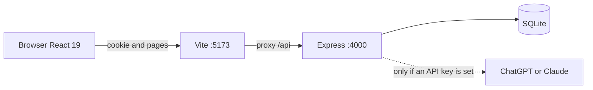
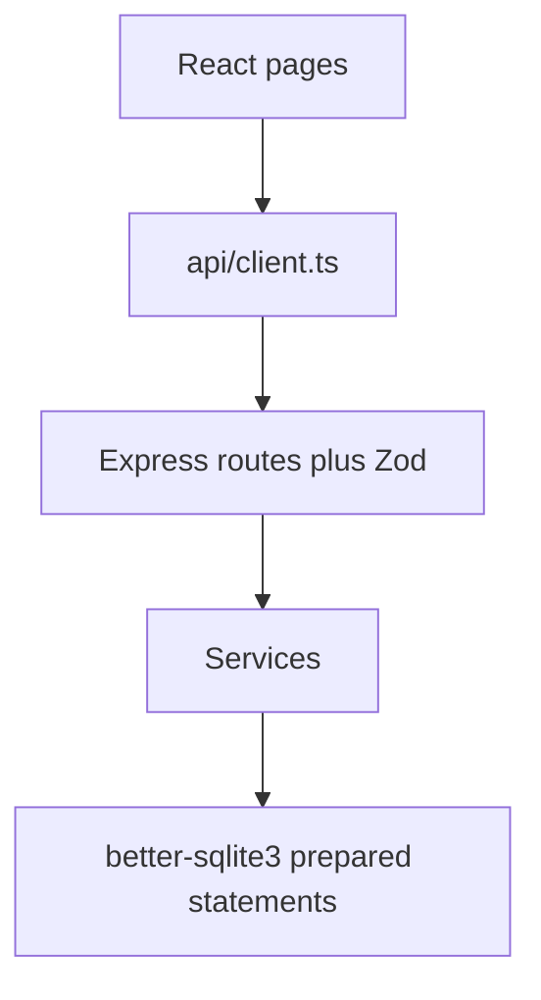
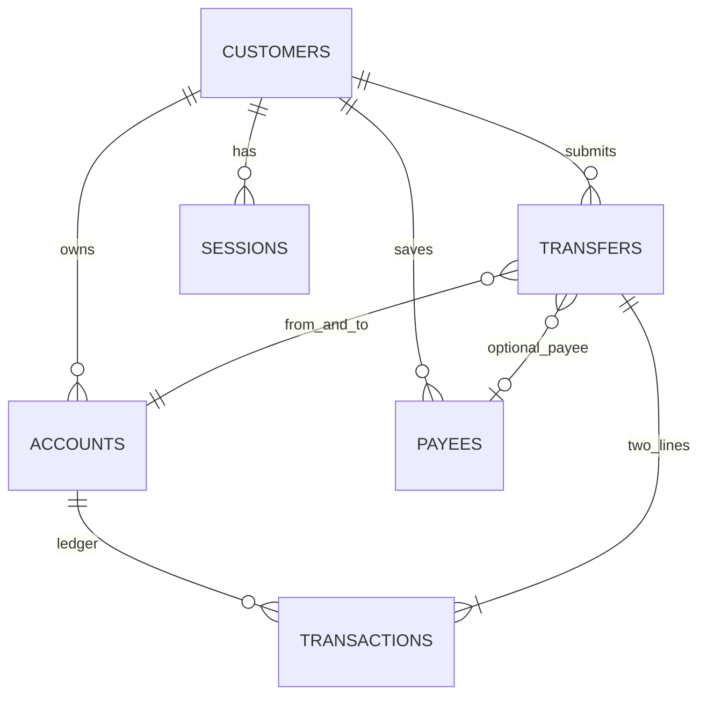
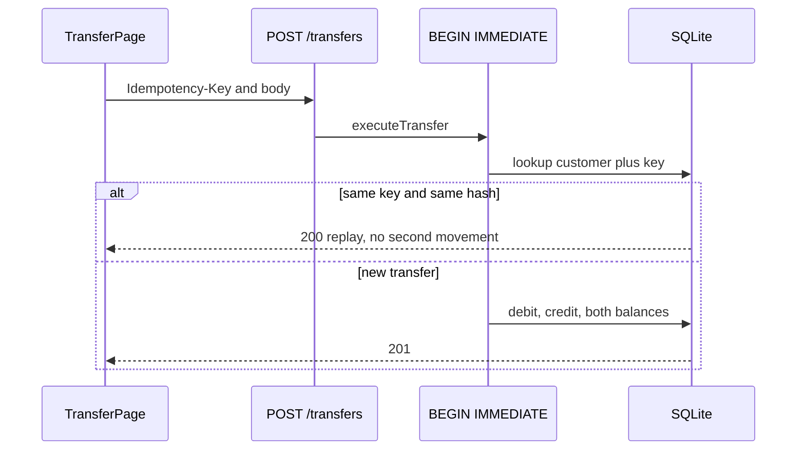
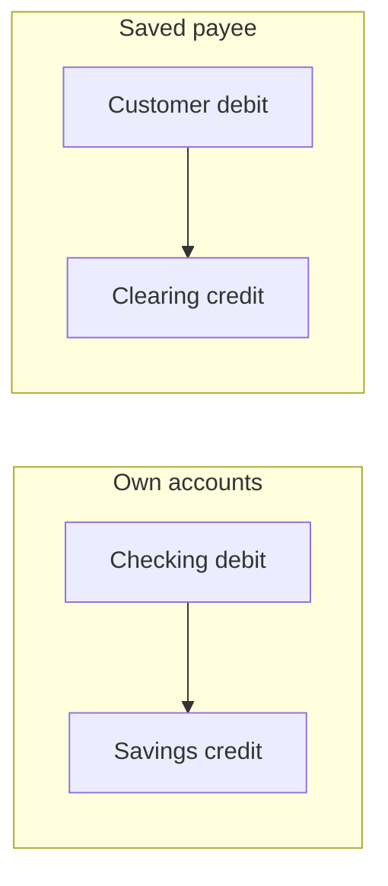
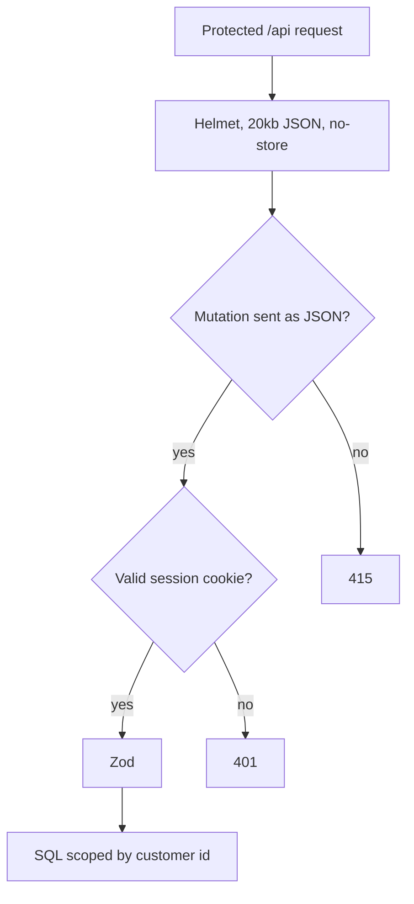
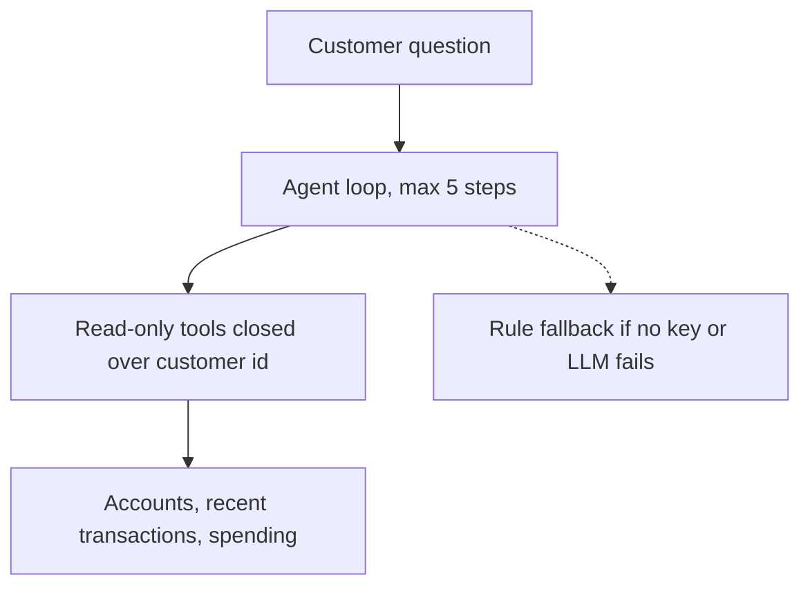
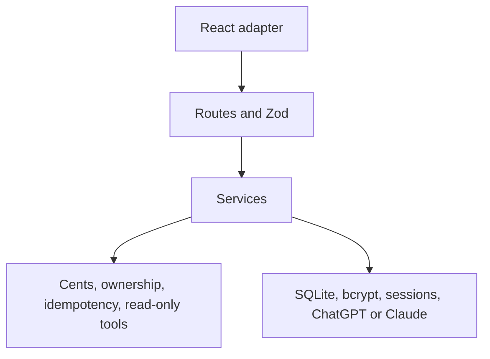
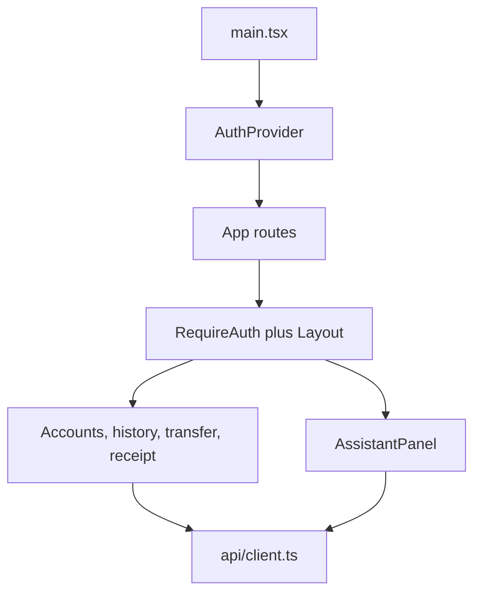
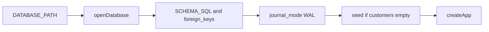

# Kestrel Bank — architecture diagrams

Open [`index.html`](index.html) in a browser to see these diagrams drawn. Each diagram also has its own source file in [`diagrams/`](diagrams/).

Diagrams of the running demo: React 19 + Vite, Express 5, SQLite via better-sqlite3.
They match the code. This app is one API process and one web app. It does not use Entity Framework, microservices, or a cloud deployment.

## 1. Runtime

The browser never talks to SQLite or to the model provider. Vite proxies `/api` to port 4000, so the session cookie stays same-origin and `SameSite=Strict`. ChatGPT is used when `OPENAI_API_KEY` is set. Claude is used only when that key is empty and `ANTHROPIC_API_KEY` is set. With neither key, the same read-only tools run through the rule-based responder.

## 2. Request path

Pages never build SQL. `client/src/api/client.ts` is the only fetch wrapper. Routes validate with Zod and call services. Services are the only layer that prepares statements. `server/src/index.ts` opens the database once and passes it into `createApp`.

## 3. Data model

Money is integer cents. An in-app transfer is one `transfers` row and exactly two `transactions` rows. Payee payments credit `acc_bank_clearing`, whose `customer_id` is null. Sessions store the SHA-256 of the cookie, not the cookie. Seeded payroll and shop lines are single-sided and have a null `transfer_id`. Schema: `server/src/db/schema.ts`.

## 4. Transfer, exactly once

The idempotency key is created when the customer reaches Review and kept in `sessionStorage`. `executeTransfer` in `server/src/services/transfers.ts` runs inside `db.transaction().immediate()`, so the write lock is taken before the key lookup. `UNIQUE(customer_id, idempotency_key)` is the backstop. The same key and the same request hash return 200 with `Idempotent-Replayed: true`. The same key with different details returns 409. A rejected attempt, such as insufficient funds, is not stored.

## 5. Where the money goes

An own-account transfer debits one of the customer's accounts and credits the other. A payee payment debits the customer and credits the clearing account, because the payee's bank is outside this system. Each ledger line stores `balance_after_cents`. Customer balances cannot go negative: the service checks funds, and the table has `CHECK (type = 'clearing' OR balance_cents >= 0)`.

## 6. Security on a protected request

Login, logout, and `GET /api/health` are public. Logout only revokes the cookie it is given. Every other banking route is behind `requireAuth`. Another customer's account, payee, or transfer returns 404. The clearing account is not owned by the customer, so it is 404 as well. Full account numbers are masked before they leave `toAccount`.

Other controls, not drawn as boxes: bcrypt with a dummy hash for unknown usernames, five failures per username and IP then 429, 256-bit session token stored only as SHA-256, `HttpOnly` + `SameSite=Strict` cookie, `Secure` in production, 30-minute sliding idle timeout.

## 7. Assistant

`askAssistant` in `server/src/services/assistant/index.ts` builds three tools closed over the signed-in customer id: accounts, recent transactions, and spending. `llmAssistant.ts` allows at most five tool rounds. There is no tool that creates a transfer. If the provider call fails, or no API key is set, `mockAssistant.ts` answers from the same tools. The system prompt tells the model that tool results are data, not instructions.

## 8. Layer mapping

This is the shape of the code, not a separate Clean Architecture solution. Rules live inside the services. Routes are the inbound adapter. SQLite, bcrypt, sessions, and the Anthropic HTTP call are outbound. The React checks in `validateTransfer` are feedback only. `executeTransfer` is the authority.

## 9. Client composition

`RequireAuth` waits on `GET /api/auth/me`, then renders `Layout`. History and the transfer receipt remount when the id in the URL changes, so a previous response cannot stay on screen. Filters for history live in the query string.

## 10. Database startup

`DATABASE_PATH` defaults to `:memory:`, which reseeds on every start. A file path keeps the file between restarts. Seed runs only when `customers` is empty. Tests open their own `:memory:` database and pass it into `createApp`.

